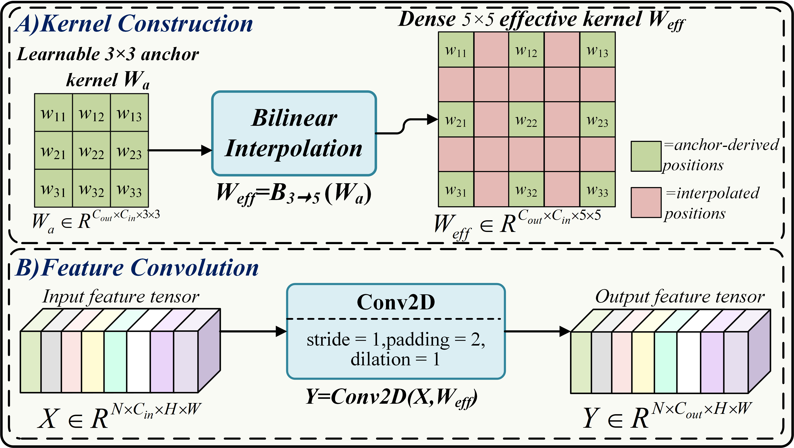
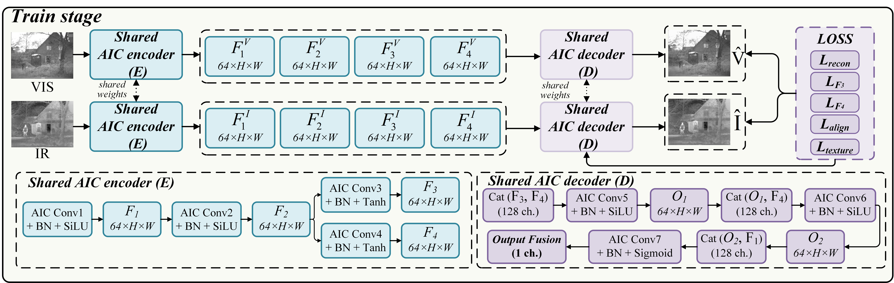
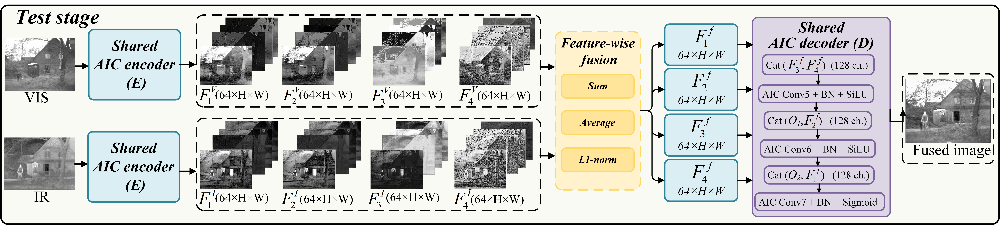
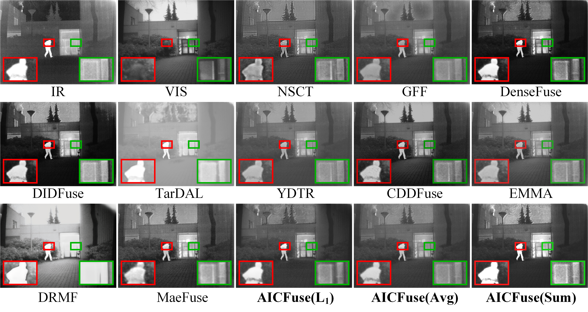
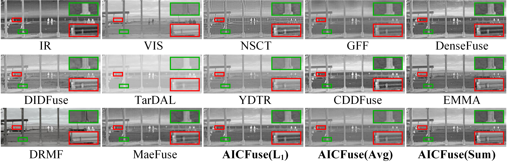
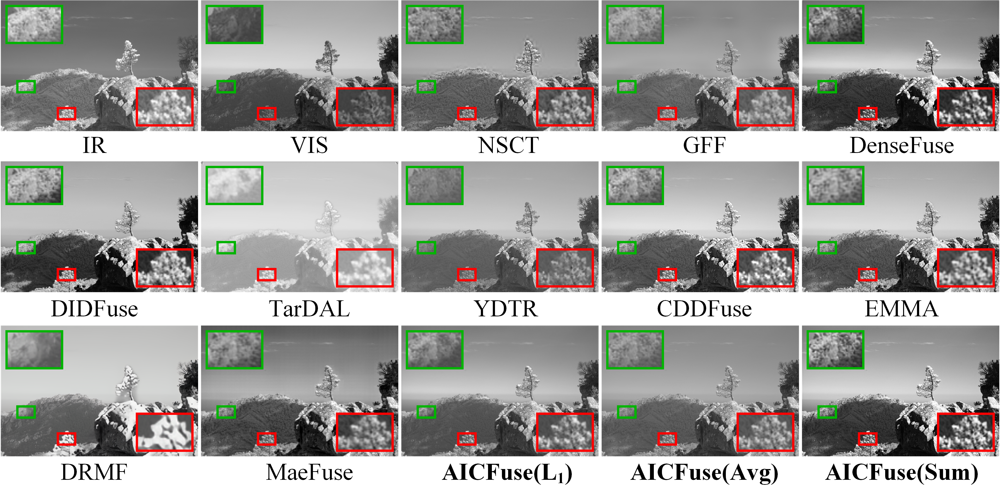

# AICFuse

Core training, testing and network code for AICFuse with pure bilinear interpolation convolution. No pretrained weights are included.

Each convolution learns a 3 x 3 kernel and directly interpolates it to a dense target kernel with `torch.nn.functional.interpolate(mode="bilinear", align_corners=True)`. A single convolution then applies that kernel. The kernel construction has no gate, local-kernel branch or energy normalization.

| Model | Kernel interpolation | Trainable parameters |
| --- | --- | ---: |
| `PureInterp5` | 3 x 3 to 5 x 5 | 260,546 |
| `PureInterp7` | 3 x 3 to 7 x 7 | 260,546 |
| `PureInterp9` | 3 x 3 to 9 x 9 | 260,546 |

## Figures







### Selected comparisons

Qualitative comparisons on TNO (scene 16), FLIR (scene 19) and NIR (Country scene 13).







## Setup

Run commands from this repository's root directory. Install a matching PyTorch and torchvision build for your CPU or CUDA environment, then install the remaining requirements:

```bash
python -m pip install -r requirements.txt
```

Check network shapes and parameter counts:

```bash
python pure_models.py
```

## Training

Prepare training data separately; it is not included. The split script expects a FLIR archive containing 540 paired images under `IR/` and `VIS/` (nested folders are supported). Stems `0001` through `0180` identify the 180 original scene pairs. Only those originals enter the fixed split; the other stored images are not used.

```text
Datasets/Train_data_FLIR_aug540/
  IR/IR/0001.jpg ... 0540.jpg
  VIS/VIS/0001.jpg ... 0540.jpg
```

Create the split locally so its image paths match your machine:

```bash
python make_split.py --data_root ./Datasets/Train_data_FLIR_aug540
python train.py --variant PureInterp5
```

The defaults use split seed 2026, 162 training originals and 18 validation originals. Three paired random crop/flip views per original yield 486 training samples per epoch. Validation uses deterministic center crops. Training runs for 120 epochs with seed 2026, batch size 24 and crop size 128. The validation objective selects the best checkpoint.

Use `--variant PureInterp7` or `--variant PureInterp9` to select another kernel size. Use `--seed 2027` or `--seed 2028` for additional runs. Options are listed by `python train.py --help`.

## Testing

The included external test sets contain 132 paired images: TNO (40 pairs), NIR (52 pairs) and FLIR (40 pairs). Each pair has matching numeric stems in `ir/` and `vi/`; indices are consecutive from 1 within each dataset.

```text
test_datasets/
  TNO/ir/1.bmp ... 40.bmp
  TNO/vi/1.bmp ... 40.bmp
  NIR/ir/1.png ... 52.png
  NIR/vi/1.png ... 52.png
  FLIR/ir/1.jpg ... 40.jpg
  FLIR/vi/1.jpg ... 40.jpg
```

Check pair counts, then test using checkpoints produced by your own training run:

```bash
python external_datasets.py
python test.py --variant PureInterp5 --dataset all --mode Sum
```

`--mode` also accepts `Average` and `l1_norm`. The model variant and seed must match training. The default checkpoint is `best`; `--checkpoint last` selects the final epoch instead. Checkpoints and fused PNG images are written under `results/<variant>/seed_<seed>/`.

No model weights are distributed in this repository. Testing requires the `Encoder_best.pkl` and `Decoder_best.pkl` files generated by training (or the corresponding `last` files).

## Files

- `pure_interp_module.py`: pure interpolation convolution.
- `pure_models.py`: encoder and decoder for all three kernel sizes.
- `losses.py`: reconstruction-related losses, feature normalization and loss schedule.
- `make_split.py`: fixed training/validation split.
- `train.py`: paired training and validation.
- `test.py`: feature fusion and image generation.
- `external_datasets.py`: external test-pair validation.
